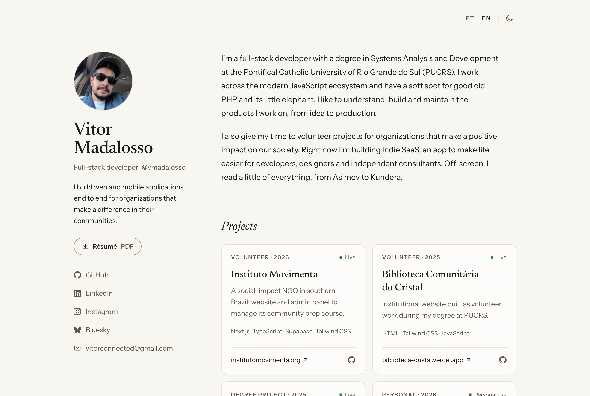

# vmadalosso.dev

Personal website and portfolio of **Vitor Madalosso**, full-stack developer.

**Live at [vmadalosso.dev](https://vmadalosso.dev)** · [Leia em português](README.pt-BR.md)

<picture>
  <source media="(prefers-color-scheme: dark)" srcset="docs/screenshots/home-en-dark.webp">
  
</picture>

Modern PHP with **no framework** and **no database**. Content lives in versioned PHP files, and a build step turns the site into static HTML that is deployed to Cloudflare Pages on every push.

## Highlights

- **No runtime dependencies.** Composer is only used for PSR-4 autoloading. Routing, templates and translations are a few hundred lines of plain PHP 8.4.
- **Small and fast.** A first visit downloads about 125 KB in total (HTML, CSS, fonts and photo, compressed). The only JavaScript is about 20 inline lines for the light/dark theme.
- **Valid HTML.** The W3C validator reports no errors or warnings on either language version.
- **Accessible colors, measured.** Every color pair meets WCAG AA in both themes: body text above 14:1, secondary text above 6.5:1 and control borders above 3:1.
- **Bilingual.** Portuguese at `/` and English at `/en/`, with `hreflang` links, a sitemap and schema.org data.
- **Automatic deploys.** GitHub Actions builds the site and publishes it to Cloudflare Pages in under a minute.

## Stack

| Layer | Choice |
| --- | --- |
| Language | PHP 8.4 with `strict_types`, enums, `readonly` classes, `match` and named arguments |
| Structure | Composer for autoloading only (PSR-4), no runtime dependencies |
| Templates | Plain PHP (`views/`), with `e()` escaping every dynamic value |
| CSS | Tailwind CSS v4 through the standalone CLI (`bin/tailwind`): a single binary, no Node |
| Content | `content/*.php` files that return ready-made objects |
| JavaScript | Only the light/dark theme |
| Hosting | Static `dist/` on Cloudflare Pages |

## How a page is built

1. `public/index.php` receives the request (front controller).
2. `App::handle()` reads the language from the path (`/en/...`) and picks the page with a `match` on the path.
3. `View` renders `views/pages/<page>.php` and wraps it in `views/layout.php`.
4. A `Response` comes out with the status, headers and HTML.

The build script (`bin/build.php`) calls the same `App::handle()` for every URL in `App::staticPages()` and writes the result to `dist/`, so what runs in development is exactly what gets deployed.

```
bin/          dev, tailwind, build.php
content/      the "database": profile, projects, books, stack, setup
lang/         interface strings (pt, en)
public/       web root: index.php, fonts, images, favicon, _headers
resources/    Tailwind CSS and SVG icons
src/          App, Content/, I18n/, View/, Http/
views/        layout, pages and partials
docs/         README screenshots
```

## Decisions

- **No framework.** The site has a handful of pages and no business logic. A router, templates and content loading fit in a few hundred readable lines, with nothing to upgrade every year.
- **No database.** Content rarely changes and is edited by a developer. Files in git give versioning for free, with no migrations or backups.
- **Static output.** The same PHP code runs locally and renders the HTML at build time, so production needs no PHP server: hosting is free and there is nothing to patch.
- **Measured contrast.** Colors are tokens in `resources/css/app.css`, and every pair was checked against WCAG AA in both themes. A color change means measuring again.
- **Self-hosted fonts.** Newsreader (headings and book titles) and Instrument Sans (body text), latin subset only: about 77 KB in total, with no request to Google on each visit.

## Running locally

```bash
composer install   # generates the autoloader
composer dev       # http://localhost:8000 (PHP server + Tailwind in watch mode)
```

With Laravel Herd, `herd link vmadalosso` serves the site at `http://vmadalosso.test`. In that case, keep the CSS compiling with `bin/tailwind --watch=always`.

## Editing content

| What | Where |
| --- | --- |
| Bio, about text, social links, résumé, email | `content/profile.php` |
| Projects (featured, "building now" and others) | `content/projects.php` |
| Books | `content/books.php` |
| Tech stack | `content/stack.php` (icons in `resources/icons/`, from [Simple Icons](https://simpleicons.org)) |
| Setup | `content/setup.php` |
| Interface strings | `lang/pt.php` and `lang/en.php` |
| Résumé PDF | `public/cv/vitor-madalosso.pdf` |

Translated values use `['pt' => '...', 'en' => '...']`.

## Build and deploy

```bash
composer build     # minified CSS + static site in dist/
```

Every push to `main` runs `.github/workflows/deploy.yml`, which builds the site and publishes `dist/` to Cloudflare Pages (project `vmadalosso-dev`). It needs two repository secrets:

| Secret | What it is |
| --- | --- |
| `CLOUDFLARE_API_TOKEN` | Cloudflare token with the "Account · Cloudflare Pages · Edit" permission |
| `CLOUDFLARE_ACCOUNT_ID` | Cloudflare account ID |

`public/_headers` sets the HTTP headers on Pages: security headers, plus long-lived caching for fonts and CSS.
