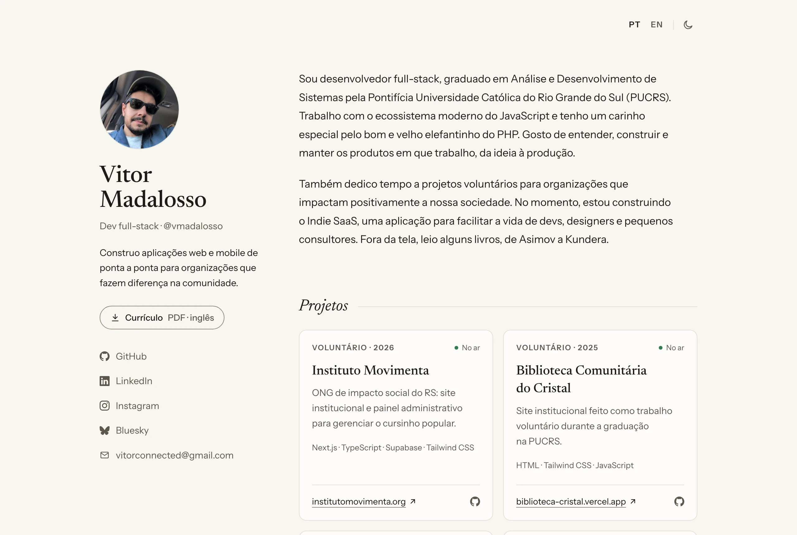

# vmadalosso.dev

Site pessoal e portfólio de **Vitor Madalosso**, dev full-stack.

**No ar em [vmadalosso.dev](https://vmadalosso.dev)** · [Read in English](README.md)

<picture>
  <source media="(prefers-color-scheme: dark)" srcset="docs/screenshots/home-pt-dark.webp">
  
</picture>

PHP moderno, **sem framework** e **sem banco de dados**. O conteúdo fica em arquivos PHP versionados no git, e o build transforma o site em HTML estático, publicado no Cloudflare Pages a cada push.

## Destaques

- **Nenhuma dependência em produção.** O Composer serve só para o autoload (PSR-4). Rotas, templates e traduções cabem em poucas centenas de linhas de PHP 8.4 puro.
- **Leve e rápido.** A primeira visita baixa cerca de 125 KB no total (HTML, CSS, fontes e foto, comprimidos). O único JavaScript são umas 20 linhas para o tema claro/escuro.
- **HTML válido.** O validador do W3C não aponta nenhum erro nem aviso nas duas versões de idioma.
- **Cores acessíveis, medidas.** Todo par de cor passa no WCAG AA nos dois temas: texto acima de 14:1, texto secundário acima de 6,5:1 e bordas de controle acima de 3:1.
- **Bilíngue.** Português em `/` e inglês em `/en/`, com `hreflang`, sitemap e dados estruturados (schema.org).
- **Deploy automático.** O GitHub Actions gera o site e publica no Cloudflare Pages em menos de um minuto.

## Stack

| Camada | Escolha |
| --- | --- |
| Linguagem | PHP 8.4 com `strict_types`, enums, classes `readonly`, `match` e argumentos nomeados |
| Estrutura | Composer só para o autoload (PSR-4), sem dependências em produção |
| Templates | PHP puro (`views/`), com `e()` escapando todo dado dinâmico |
| CSS | Tailwind CSS v4 pelo CLI standalone (`bin/tailwind`): um binário, sem Node |
| Conteúdo | `content/*.php`, que devolvem objetos prontos |
| JavaScript | Só o tema claro/escuro |
| Hospedagem | `dist/` estático no Cloudflare Pages |

## Como uma página é montada

1. `public/index.php` recebe a requisição (front controller).
2. `App::handle()` separa o idioma (`/en/...`) e escolhe a página com um `match` no caminho.
3. `View` renderiza `views/pages/<página>.php` e depois a envolve no `views/layout.php`.
4. Sai uma `Response` com status, cabeçalhos e HTML.

O build (`bin/build.php`) usa o mesmo `App::handle()` para cada URL de `App::staticPages()` e grava o resultado em `dist/`. Então o que roda em desenvolvimento é exatamente o que vai para o ar.

```
bin/          dev, tailwind, build.php
content/      o "banco": perfil, projetos, livros, stack, setup
lang/         textos da interface (pt, en)
public/       raiz web: index.php, fontes, imagens, favicon, _headers
resources/    CSS do Tailwind e ícones SVG
src/          App, Content/, I18n/, View/, Http/
views/        layout, páginas e partials
docs/         prints do README
```

## Decisões

- **Sem framework:** o site tem poucas páginas e nenhuma regra de negócio. Roteador, templates e leitura do conteúdo cabem em poucas centenas de linhas legíveis, sem nada para atualizar todo ano.
- **Sem banco:** o conteúdo muda pouco e quem edita é dev. Arquivo no git dá versionamento de graça, sem migration nem backup.
- **Saída estática:** o mesmo código PHP roda localmente e gera o HTML no build, então produção não precisa de servidor PHP. A hospedagem é grátis e não há nada para manter atualizado.
- **Contraste medido:** as cores são tokens em `resources/css/app.css`, e cada par foi conferido contra o WCAG AA nos dois temas. Mudou uma cor, mede de novo.
- **Fontes self-hosted:** Newsreader (títulos e livros) e Instrument Sans (texto), só com o subconjunto latino: cerca de 77 KB no total, sem nenhuma chamada ao Google a cada visita.

## Rodando localmente

```bash
composer install   # gera o autoload
composer dev       # http://localhost:8000 (servidor do PHP + Tailwind em modo watch)
```

Com o Laravel Herd, `herd link vmadalosso` serve o site em `http://vmadalosso.test`. Nesse caso, deixe o CSS compilando com `bin/tailwind --watch=always`.

## Editando o conteúdo

| O quê | Onde |
| --- | --- |
| Bio, "Sobre", redes, currículo, e-mail | `content/profile.php` |
| Projetos (destaque, "construindo agora" e outros) | `content/projects.php` |
| Livros | `content/books.php` |
| Tecnologias | `content/stack.php` (ícones em `resources/icons/`, do [Simple Icons](https://simpleicons.org)) |
| Setup | `content/setup.php` |
| Textos da interface | `lang/pt.php` e `lang/en.php` |
| Currículo em PDF | `public/cv/vitor-madalosso.pdf` |

Os textos traduzidos usam `['pt' => '...', 'en' => '...']`.

## Build e deploy

```bash
composer build     # CSS minificado + site estático em dist/
```

A cada push na `main`, o workflow `.github/workflows/deploy.yml` gera o site e publica `dist/` no Cloudflare Pages (projeto `vmadalosso-dev`). Ele precisa de dois secrets no repositório:

| Secret | O que é |
| --- | --- |
| `CLOUDFLARE_API_TOKEN` | Token da Cloudflare com a permissão "Account · Cloudflare Pages · Edit" |
| `CLOUDFLARE_ACCOUNT_ID` | ID da conta na Cloudflare |

O `public/_headers` define os cabeçalhos HTTP do Pages: segurança, e cache longo para fontes e CSS.
